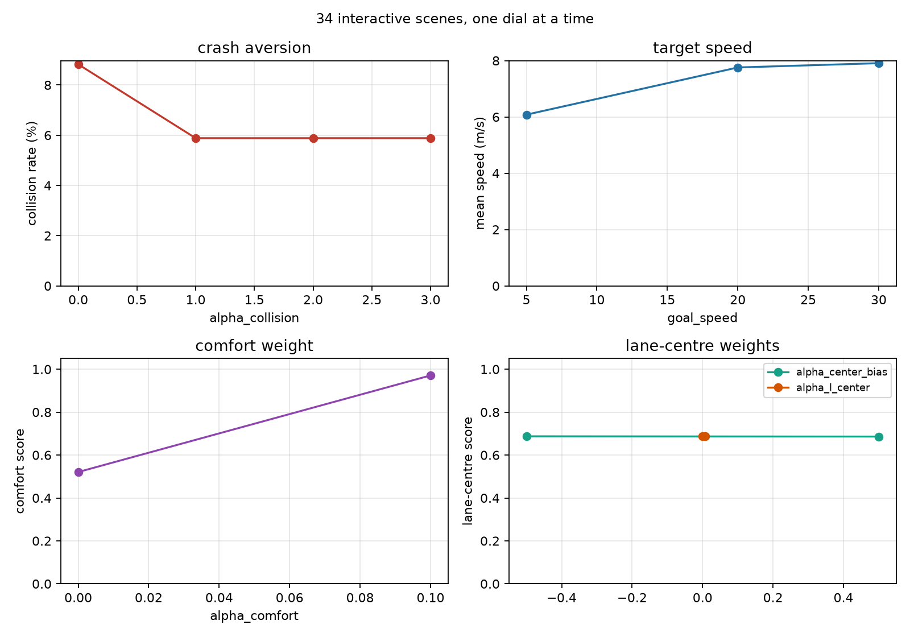
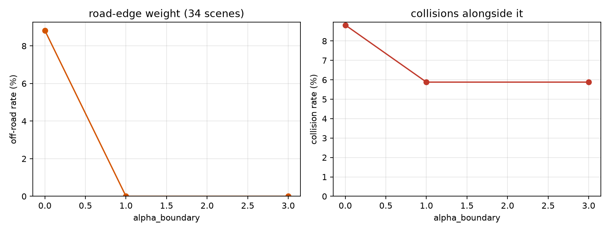
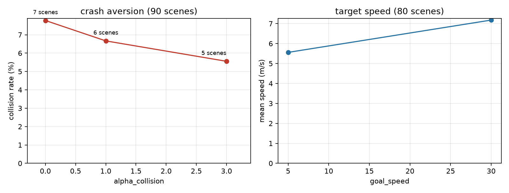

# Steering a driving policy with reward weights

BehaviorBench has a driving policy that reads ten reward weights from its
observation. The weights are meant to work like dials: turn up crash aversion and
the same network should drive more carefully, with no retraining.

This folder checks whether that happens. The policy is frozen, so any change in
behaviour has to come from the weights in the observation.

## Setup

I used 1,000 Waymo validation scenes and converted them to the simulator's binary
format. Each scene was ranked by how many other agents pass within 10 m of the ego,
and the most interactive scenes were kept. A safety weight only has a chance to
matter when there is traffic.

For each setting of one weight, the policy drove the ego while IDM controlled the
other agents. Every other weight stayed at the BehaviorBench default. The
evaluation code is BehaviorBench's own, so the numbers come from the same harness
as the paper. Each dial is compared on the scenes that all of its settings share.

## Results

The first table uses 34 interactive scenes. Target speed is measured on 45
scenes, because those are the ones its settings share.

| dial | settings | collision rate | mean speed (m/s) | goal reached | reading |
|---|---|---|---|---|---|
| crash aversion | 0 / 1 / 2 / 3 | 8.8 / 5.9 / 5.9 / 5.9 % | 9.35 / 9.37 / 9.37 / 9.39 | 82 / 82 / 82 / 85 % | turns, then flat |
| road edge | 0 / 1 / 3 | 8.8 / 5.9 / 5.9 % | 9.44 / 9.40 / 9.39 | 79 / 85 / 85 % | off-road 8.8 → 0 % |
| target speed | 5 / 20 / 30 | 2.2 / 2.2 / 4.4 % | 6.08 / 7.76 / 7.91 | 80 / 84 / 84 % | turns, more collisions at 30 |
| comfort | 0 / 0.1 | 5.9 / 5.9 % | 11.05 / 8.76 | 94 / 77 % | turns, with a speed cost |
| centre bias | -0.5 / 0.5 | 5.9 / 5.9 % | 9.39 / 9.38 | 85 / 85 % | flat |
| lane centre | 0.00025 / 0.0075 | 5.9 / 5.9 % | 9.39 / 9.38 | 85 / 85 % | flat |

The larger run repeats the two dials that moved, on the 100 most interactive
scenes.

| dial | settings | collision rate | mean speed (m/s) | goal reached | scenes with a collision |
|---|---|---|---|---|---|
| crash aversion | 0 / 1 / 3 | 7.8 / 6.7 / 5.6 % | 7.36 / 7.36 / 7.38 | 80 / 79 / 81 % | 7 / 6 / 5 |
| target speed | 5 / 30 | 3.8 / 3.8 % | 5.56 / 7.18 | 74 / 83 % | 3 / 3 |







Crash aversion is the clearest result. Most of the change happens at the first
step: the collision rate falls from 8.8% to 5.9% and then stays there. On the
larger sample it falls from 7.8% to 5.6%, and the number of scenes with a
collision falls from 7 to 5. Speed does not change, so the safety gain is not
coming from slower driving.

Road edge is the second clear safety dial. At 0 the off-road rate is 8.8% and
three scenes leave the road. At 1 and 3 it is zero. Collisions fall at the same
time because the scenes that leave the road also count as collisions. The two
remaining collisions are not affected by this weight, so the dial fixes the
off-road failures but not the crash failures.

Target speed moves speed as expected, from 6.1 to 7.9 m/s on the small sample
and from 5.6 to 7.2 m/s on the larger one. Goal completion rises with it because
a faster agent reaches more goals inside the 9.1 s episode. Collisions also rise
at the top setting on the small sample, from 2.2% to 4.4%, which is the trade-off
that comes with the higher speed.

Comfort is a strong dial too, but it trades speed for smoothness. At 0.1 the
comfort score goes from 0.52 to 0.97 while speed drops from 11.1 to 8.8 m/s and
goal completion falls from 94% to 77%. The comfort score is the quantity the
weight controls, so the speed and goal numbers are the independent evidence that
behaviour changed.

Centre bias and lane-centre are flat. The lane-centre score moves by less than
0.002. Either the policy ignores those weights, or these scenes do not offer a
meaningful choice of lane position. The data here cannot separate the two.

## What a flat dial means

A flat line is still a result. It means the policy did not learn to use that
weight, or the scenes do not expose the behaviour it controls. A table of which
dials work and which do not says more than one successful curve.

## Reproduce

```bash
git clone --depth 1 -b main-behavior-bench \
  https://github.com/boschresearch/behavior-bench.git
cd behavior-bench
NO_TRAIN=1 python setup.py build_ext --inplace
```

Then, from the folder that contains `data/maps/validation`:

```bash
export DRIVE_BINARIES_DATA_ROOT=$PWD/data/maps

python conditioning_sweep/run_grid.py --workers 3 --chunk 10
python conditioning_sweep/final_report.py --runs runs --out conditioning_sweep/results
```

A single dial can also be run on its own:

```bash
python conditioning_sweep/sweep.py \
  --repo behavior-bench \
  --knob alpha_collision \
  --values 0 1 3
```

## Caveats

- The policy is deterministic, so a scene gives the same result at a fixed
  setting. The noise comes from which scenes are in the sample.
- The ego is one agent per scene and the other agents are IDM. Conditioning every
  agent at once is a different experiment.
- `goal_speed` and `delta_goal` change the task, not the style. Keep them
  separate from the `alpha_*` weights in any claim about driving style.
- Collisions are rare. A difference of one or two scenes is a direction, not a
  confidence interval.

## Files

- `sweep.py` runs one dial and writes `results.csv` plus `plot.png`.
- `run_grid.py` runs many dials in parallel, in resumable chunks.
- `make_manifest.py` ranks scenes by traffic around the ego.
- `final_report.py` builds the committed tables and figures.
- `results/` holds the plots and CSV used in this writeup.
